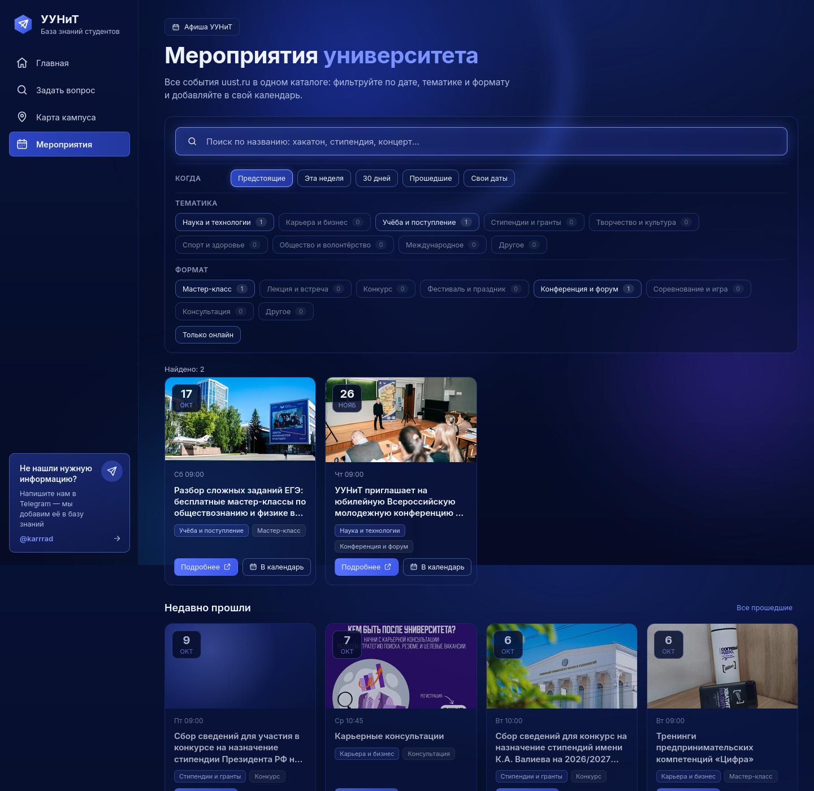
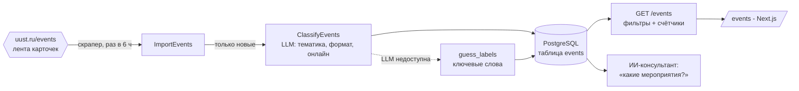

# Афиша УУНиТ - каталог мероприятий

Подпроект внутри портала: вкладка **«Мероприятия»** (`/events`) - все события университета с
фильтрацией по дате, тематике и формату. Прод - https://karrad.tech/uunit/events.

## Зачем

На uust.ru мероприятия публикуются лентой карточек: ни тематик, ни форматов, ни фильтров по
датам. Найти «что интересного по науке на этой неделе» или «какие сейчас конкурсы на стипендии»
нельзя. Каталог собирает те же события автоматически и делает их фильтруемыми.

## Как устроено

| Слой | Модуль | Что делает |
|---|---|---|
| domain | `domain/event.py` | `RawEvent`, `Event`, `EventQuery`; справочники `TOPICS` (9) и `FORMATS` (8); запасная разметка `guess_labels` |
| repositories | `uust_events_repository.py` | Разбор карточек `a.event` на `uust.ru/events/?page=N`: slug, название, дата и время, обложка |
| repositories | `postgres_events_repository.py` | Таблица `events`, фильтрация на SQL (`build_where`), подсчёт фасетов |
| use_cases | `classify_events.py` | Один вызов LLM на пачку из 10 событий; не разметила - правила; после первого отказа LLM в прогоне больше не вызывается |
| use_cases | `import_events.py` | Новые события -> разметка -> сохранение пачками; известные пропускаются без LLM |
| use_cases | `list_events.py` | Каталог + счётчики по каждой тематике и формату |
| use_cases | `find_events.py` | Поиск мероприятий для ответа консультанта: слова, даты, тематика; без дат - предстоящие + недавние |
| use_cases | `latest_news.py` | Сводка ближайших событий к вопросам «что нового» |
| frontend | `app/events/page.tsx`, `lib/events.ts` | Страница каталога, запрос к API, файл `.ics` «В календарь» |

## Справочники

| Тематики | Форматы |
|---|---|
| Наука и технологии | Мастер-класс |
| Карьера и бизнес | Лекция и встреча |
| Учёба и поступление | Конкурс |
| Стипендии и гранты | Фестиваль и праздник |
| Творчество и культура | Конференция и форум |
| Спорт и здоровье | Соревнование и игра |
| Общество и волонтёрство | Консультация |
| Международное | Другое |
| Другое | |

Плюс признак «онлайн». LLM отвечает строго значениями из справочников; всё остальное
нормализуется в «Другое», поэтому фильтры всегда стабильны.

## Фильтры

| Фильтр | Как работает |
|---|---|
| Поиск | Подстрока в названии (`ILIKE`) |
| Когда | Предстоящие (с сегодня), неделя, 30 дней, прошедшие (до вчера, от свежих), свой диапазон. Даты - целые дни по Уфе (UTC+5), включительно |
| Тематика, формат | Мультивыбор; на каждом чипе - сколько событий при текущих датах и поиске |
| Только онлайн | `online = true` |

Под «Предстоящими» показываются 9 недавно прошедших с теми же фильтрами: на сайте вуза анонсов
вперёд обычно немного. Кнопка «В календарь» скачивает `.ics` (Google, Apple, Яндекс календарь,
Outlook); длительности на сайте нет - ставим полтора часа.

## Консультант и каталог

Планировщик вопроса (ADR 002) выделяет часть **`events`**: «будут ли хакатоны в октябре?» ->
`{"keywords": ["хакатон"], "date_from": "2026-10-01", "date_to": "2026-10-31"}`. `FindEvents`
ищет её в таблице `events`, а не в векторной базе:

- слова - любое в названии (`хакатон`, `олимпиад`); тематика учитывается, только если слов нет;
- без дат - сначала предстоящие, если их меньше трёх - плюс 5 недавно прошедших;
- по словам ничего - повтор только по датам, с честной пометкой «по словам не нашлось»;
- найденное (даты по Уфе, «прошло/предстоит», ссылки) - одним фрагментом в контекст ответа.

Вопросы о правилах участия и документах остаются поиском по базе знаний (`search`); в одном
сообщении могут быть обе части. Ответы с афишей не кэшируются - они зависят от даты.

## API

`GET /events` и `POST /events/import` - см. [api.md](api.md#get-events).

## Настройки

| Переменная | По умолчанию | Смысл |
|---|---|---|
| `EVENTS_IMPORT_INTERVAL_HOURS` | `6` | Как часто обновлять каталог; `0` - только вручную |
| `EVENTS_IMPORT_PAGES` | `15` | Сколько страниц uust.ru/events просматривать (по 12 событий) |

Первый прогон - через 2 минуты после старта бэкенда. Почему решено так - ADR 013.
